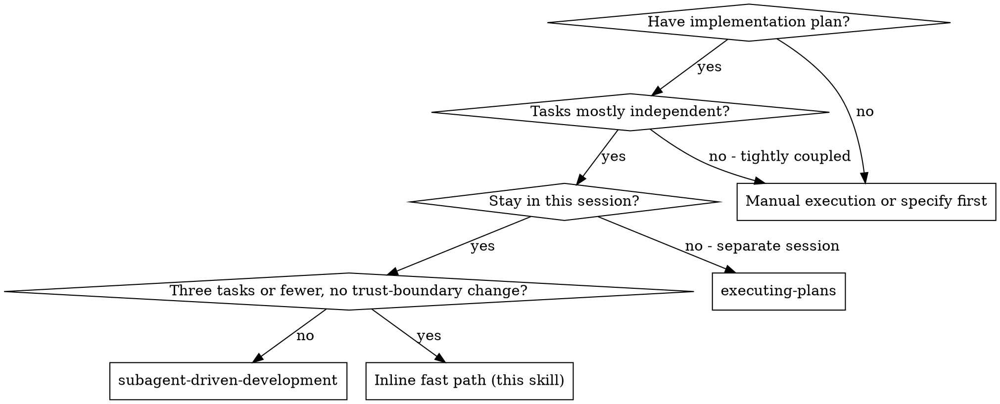
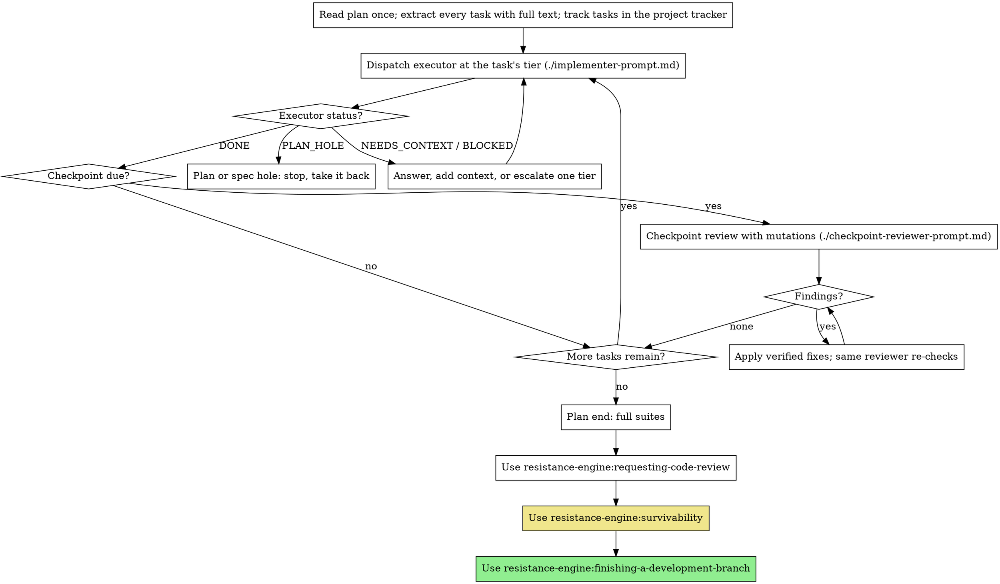

# Subagent-Driven Development

Execute a plan by dispatching a fresh executor per task at the tier the plan tags, with a checkpoint review every three to five tasks that runs a mutation for each "Reviewer looks at" item, then full suites, code review and survivability at plan end.

**Why subagents:** You delegate tasks to agents with isolated context. By crafting their instructions precisely, you keep them focused on their task. They never inherit your session's context or history — you construct exactly what they need. This also keeps your own context for coordination.

**Core principle:** Cheap executors transcribe a complete plan; a strong reviewer with real mutations proves the tests catch faults. The plan writer owns completeness, the checkpoint reviewer owns test sufficiency, and the coordinator keeps the two honest.

**Announce at start:** "I'm using the subagent-driven-development skill to execute this plan."

## When to Use



## What the plan provides

This skill reads the plan format from `writing-plans`:

- **Tier** per task (`fast`, `standard` or `strong`), which picks the executor.
- **Callers that move with this task**, which the executor edits and tests in the same commit.
- **Reviewer looks at** items per task: a decision point, a mutation and the test that should kill it.
- **Checkpoints** table, which says when to run each checkpoint review and what it covers.
- **Trust boundary** line in the header, and the **Trust-boundary table** when it changed.

If any of these is missing, stop and send the plan back to `writing-plans`. Do not invent tiers or checkpoints during execution.

## The Process



Track every task in the project's tracker (GitHub issues, beads, or whatever the repo uses), not in a session-only to-do list. Record on the work item, per task: tier, attempts, escalations and tokens. `finishing-a-development-branch` turns these into the run record.

## Tiered executors

Dispatch each task's executor at the **Tier:** the plan gives it. Tiers are model-neutral; a repo-root overlay maps them to models (on Claude: fast = Haiku, standard = Sonnet, strong = Opus).

- **fast** — mechanical work where the plan gives complete code and exact commands.
- **standard** — the default; breadth work and integration across a few files.
- **strong** — trust boundaries, conditional writes, idempotency, concurrency.

The plan writer already drops a tier where the plan gives complete code. Do not drop it further during execution, and do not raise it pre-emptively.

**Escalation:** Two failed attempts at the same step move the task one tier up. A failed attempt is a test that will not go green, a wrong edit the executor cannot fix, or a BLOCKED report that more context does not resolve. A strong task that fails twice goes to the owner with the failure analysis. Record each escalation (`task`, `from`, `to`, `reason`) and the attempts per task.

Zero escalations is a calibration signal, not success: it shows no task was under-tiered, not that tiers were right. A low escalation rate with one attempt per step is healthy; a rising attempt count is the early warning. The real risk is silent quality loss — tests that pass but prove nothing — which only the checkpoint mutations measure. If executor-attributable checkpoint findings rise at a tier, raise that tier back.

## Handling executor status

Executors report one of five statuses:

**DONE:** The task is committed with its tests and its callers' tests passing. Check the commit exists, then move on (or run the checkpoint if one is due).

**DONE_WITH_CONCERNS:** Read the concerns. Correctness or scope concerns go to the next checkpoint reviewer as an extra "looks at" item, or are resolved now if they block the next task. Observations are noted and carried on.

**NEEDS_CONTEXT:** Provide the missing context and resume the same executor.

**BLOCKED:** Assess the blocker:
1. A context problem: provide more context and resume the same executor.
2. Second failed attempt at the same step: escalate one tier.
3. The task breaks the per-task rule: send it back to the plan.

**PLAN_HOLE:** The plan contradicts itself, its tests, the spec or the code, or a decision is needed that the spec does not settle. Stop. A plan hole goes back to `writing-plans` (record it in the plan's change list); a missing decision goes back to the spec as an amendment. Never let an executor guess.

**Never** ignore an escalation or force the same tier to retry without changes.

## Checkpoint reviews

Run a checkpoint after the task each row of the plan's **Checkpoints** table names. Dispatch a **strong**-tier reviewer with `./checkpoint-reviewer-prompt.md`. The checkpoint review is where test sufficiency is proved, so it is never run at a lower tier.

The reviewer:
- reads the code and test diffs for the checkpoint's tasks against the plan and spec;
- runs **one mutation per "Reviewer looks at" item** on a scratch copy, never the shared checkout, and reports each as killed or survived with the test that kills it;
- gives verified test code for every survivor;
- judges each executor deviation from the plan: which of code and test is the truth;
- runs the focused tests, and the full suite only when the checkpoint says its tasks were cross-cutting.

**Handling findings:**
- Weak tests and executor slips: apply the reviewer's verified fix as a commit on top (see coordinator rules), then send the fix commit to the same reviewer to confirm.
- Plan holes: go back to the plan; record the change. Spec holes: go back to the spec as an amendment.
- Real bugs: fix with a RED test first, then the same reviewer re-checks.

**Use the same reviewer for later rounds.** Send it the fix commit; it verifies its own findings at a fraction of a fresh reviewer's cost. Start a new reviewer only for the next checkpoint.

Log every round with the append CLI described in `../shared/review-log-jsonl.md`: `--skill subagent-driven-development --phase CHECKPOINT_REVIEW`, the round, the reviewer model and `--independence`, `--reason "mutations killed=k/n"`, and one `--finding` per finding with its kind (`weak-test`, `slip`, `plan-hole`, `spec-hole`, `real-bug`, `missed-caller`). Record whether each finding is executor-attributable (`slip`) or plan-attributable — that is the measure for tier choices.

## Plan end

After the last task and its checkpoint:

1. Run the full suites — every test command the repository has, not only the plan's focused ones. Fix failures before review.
2. **REQUIRED SUB-SKILL:** Use resistance-engine:requesting-code-review for the whole branch diff. It sees across tasks, which checkpoint reviews don't, and finds real bugs on almost every plan.
3. **REQUIRED SUB-SKILL:** Use resistance-engine:survivability. Pass it the checkpoint mutation results, so it knows which decision points were already mutated; its chaos lane always runs.
4. **REQUIRED SUB-SKILL:** Use resistance-engine:finishing-a-development-branch, which writes the run record.

## Coordinator rules

- **Apply a small verified fix yourself.** When a reviewer hands you verified test code or a one-line fix, apply it, run the tests, and commit. Spawning a fix agent for a pre-verified change costs more than the change.
- **Resume, don't restart.** When an executor or reviewer stops (rate limit, timeout, a question), its work is saved: message the same agent to continue (in Claude Code, `SendMessage` to its id). Restart only when its context is the problem.
- **Give full text, not file paths.** Paste the task text, its callers and its "Reviewer looks at" items into the executor's prompt; never make it read the plan.
- **One executor at a time** in a shared checkout. Parallel executors conflict.
- **Check the commit.** After DONE, confirm the commit exists and its tests pass before dispatching the next task.
- **Carry deviations forward.** Every executor deviation from the plan goes to the next checkpoint reviewer to judge.

## Inline fast path

A plan with **three tasks or fewer** and **no trust-boundary change** may run inline: the coordinator executes the tasks itself, following the same hygiene rules as an executor (`./implementer-prompt.md`), with one commit per task.

Then, before plan end, one review covers all the tasks: dispatch the checkpoint reviewer with every task's "Reviewer looks at" items, including a **mutation** per item on a scratch copy, and handle its findings as above. Log it as `CHECKPOINT_REVIEW`. Plan end runs in full, and survivability runs its mutation lane in full because no executor-independent checkpoint ran during execution.

Say that you are taking the inline fast path, and why the plan qualifies, before starting. A plan that grows past three tasks or touches a trust boundary during execution leaves the fast path.

## Prompt Templates

- `./implementer-prompt.md` — dispatch an executor for one task
- `./checkpoint-reviewer-prompt.md` — dispatch a checkpoint reviewer

## Example Workflow

```
You: I'm using the subagent-driven-development skill to execute this plan.

[Read plan once: docs/plans/2026-10-27-42-record-loader.md]
[Extract 6 tasks with tier, callers and "Reviewer looks at" items; track them on issue #42]
[Checkpoints: C1 after Task 3, C2 after Task 6]

Task 1 (fast): add `strict` flag to load_record
[Dispatch fast executor with full task text]
Executor: DONE — RED ran and failed, GREEN passes, callers scripts/backfill.py and
tests/fakes.py moved, committed abc123.

Task 2 (standard), Task 3 (fast): same pattern, DONE.

Checkpoint C1 (tasks 1-3)
[Dispatch strong reviewer with the C1 items and diff range]
Reviewer: 5 mutations, 4 killed, 1 survived — `strict` default flipped to True passes,
because no test loads a record without passing `strict`. Verified test code attached.
Deviation: Task 2 executor renamed a fixture; code is the truth, plan wording stale.

[Apply the verified test yourself, run it, commit def456]
[Send def456 to the same reviewer]
Reviewer: survivor now killed. Approved.
[Log CHECKPOINT_REVIEW round 1 REJECTED (weak-test), round 2 APPROVED]

Tasks 4-6 ... Task 5 (strong) fails twice on a stale read → escalation is not possible
above strong, so report BLOCKED to the owner with the reviewer's analysis.

Checkpoint C2 ... approved round 1.

[Full suites] [requesting-code-review] [survivability] [finishing-a-development-branch]
```

## Red Flags

**Never:**
- Start implementation on main/master without explicit user consent
- Run an executor at a tier other than the plan's, except by escalation
- Skip a checkpoint in the plan's table, or run one without mutations
- Run mutations in the shared checkout instead of a scratch copy
- Accept a reviewer's "looks fine" without killed/survived per item
- Proceed with an unfixed survivor or an unjudged deviation
- Let an executor make a decision the spec leaves open
- Dispatch multiple executors in parallel in one checkout
- Make an executor read the plan file (provide the full text instead)
- Restart a stopped agent when it can be resumed
- Take the inline fast path for a plan with a trust-boundary change

## Integration

**Required workflow skills:**
- **resistance-engine:using-git-worktrees** - REQUIRED: Set up isolated workspace before starting
- **resistance-engine:writing-plans** - Creates the plan this skill executes, with tiers and checkpoints
- **resistance-engine:requesting-code-review** - REQUIRED at plan end
- **resistance-engine:survivability** - REQUIRED: run the Phase 4 gate before finishing
- **resistance-engine:finishing-a-development-branch** - Complete development and write the run record

**Executors should use:**
- **resistance-engine:test-driven-development** - RED before GREEN for each task

**Alternative workflow:**
- **resistance-engine:executing-plans** - Use for a separate session instead of same-session execution
