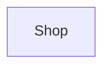

<!-- Generated by architecture-docs from the architecture model. Do not edit. -->

# Architecture

## System

## Areas

| Area | Description | Elements |
| --- | --- | --- |
| [shop](areas/shop.md) \(Shop\) |  | 10 |

## Capabilities

The model has no capability views\.

## Principles

No principles\.

## Contracts

No contracts\.

## Changes

- [2026\-11\-02\-baseline](changes/2026-11-02-baseline.md) \(2026\-11\-02\): Baseline of the whole repository: one component per group for the eight groups, a relationship per current element pair, and the inventory \-&gt; orders edge of the orders\-inventory cycle left out and gapped as cycle in current code\. \(approved by owner on 2026\-11\-02\)
- [2026\-11\-02\-order\-events](changes/2026-11-02-order-events.md) \(2026\-11\-02\): Order events: the shop system around the eight components; order events \(not yet built\) with orders \-&gt; events and reporting \-&gt; events; reporting \-&gt; payments removed and gapped \(BR\-3\); rules BR\-1 to BR\-5 assigned; the order\-event format decided once for checkout, refunds and reporting\. \(approved by owner on 2026\-11\-02\)

## Model health

- Known\-gap entries: 2, see [the improvement list](improvements.md)
- Open questions: 0, see [the improvement list](improvements.md)
- Coverage: whole repository: 10 modules \(at most 200\) and 8 groups \(at most 10\), see [the improvement list](improvements.md)
- Unmapped modules: 0, see [the improvement list](improvements.md)

## Not in any area

Every element and record is in an area\.
