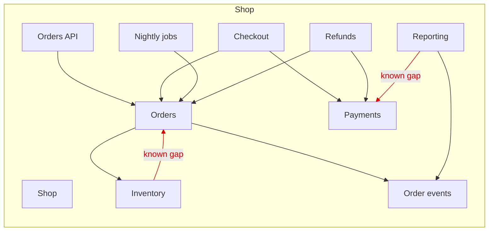

<!-- Generated by architecture-docs from the architecture model. Do not edit. -->

# Shop

## Diagram

## Elements

| Element | Title | Description | Code | Rules | Tags |
| --- | --- | --- | --- | --- | --- |
| shop | Shop |  |  |  |  |
| shop\.api | Orders API |  | shop\.api |  |  |
| shop\.checkout | Checkout |  | shop\.checkout | BR\-1 |  |
| shop\.events | Order events |  |  | BR\-5 |  |
| shop\.inventory | Inventory |  | shop\.inventory |  |  |
| shop\.jobs | Nightly jobs |  | shop\.jobs |  |  |
| shop\.orders | Orders |  | shop\.orders | BR\-4 |  |
| shop\.payments | Payments |  | shop\.payments |  | \#protected |
| shop\.refunds | Refunds |  | shop\.refunds | BR\-2 |  |
| shop\.reporting | Reporting |  | shop\.reporting | BR\-3 |  |

## Dependencies

| Element | Relation | Other end | Kind and titles | Its areas |
| --- | --- | --- | --- | --- |
| shop\.api | uses | [shop\.orders](shop.md) \(Orders\) |  | [shop](shop.md) \(Shop\) |
| shop\.checkout | uses | [shop\.orders](shop.md) \(Orders\) |  | [shop](shop.md) \(Shop\) |
| shop\.checkout | uses | [shop\.payments](shop.md) \(Payments\) |  | [shop](shop.md) \(Shop\) |
| shop\.events | used by | [shop\.orders](shop.md) \(Orders\) |  | [shop](shop.md) \(Shop\) |
| shop\.events | used by | [shop\.reporting](shop.md) \(Reporting\) |  | [shop](shop.md) \(Shop\) |
| shop\.inventory | used by | [shop\.orders](shop.md) \(Orders\) |  | [shop](shop.md) \(Shop\) |
| shop\.jobs | uses | [shop\.orders](shop.md) \(Orders\) |  | [shop](shop.md) \(Shop\) |
| shop\.orders | uses | [shop\.events](shop.md) \(Order events\) |  | [shop](shop.md) \(Shop\) |
| shop\.orders | uses | [shop\.inventory](shop.md) \(Inventory\) |  | [shop](shop.md) \(Shop\) |
| shop\.orders | used by | [shop\.api](shop.md) \(Orders API\) |  | [shop](shop.md) \(Shop\) |
| shop\.orders | used by | [shop\.checkout](shop.md) \(Checkout\) |  | [shop](shop.md) \(Shop\) |
| shop\.orders | used by | [shop\.jobs](shop.md) \(Nightly jobs\) |  | [shop](shop.md) \(Shop\) |
| shop\.orders | used by | [shop\.refunds](shop.md) \(Refunds\) |  | [shop](shop.md) \(Shop\) |
| shop\.payments | used by | [shop\.checkout](shop.md) \(Checkout\) |  | [shop](shop.md) \(Shop\) |
| shop\.payments | used by | [shop\.refunds](shop.md) \(Refunds\) |  | [shop](shop.md) \(Shop\) |
| shop\.refunds | uses | [shop\.orders](shop.md) \(Orders\) |  | [shop](shop.md) \(Shop\) |
| shop\.refunds | uses | [shop\.payments](shop.md) \(Payments\) |  | [shop](shop.md) \(Shop\) |
| shop\.reporting | uses | [shop\.events](shop.md) \(Order events\) |  | [shop](shop.md) \(Shop\) |

## Decisions

### order\-event\-format

Checkout, refunds and reporting share one order\-event format, defined by the order events component\.

- Reason: All three capabilities produce or consume the same events about an order \(the epic's shared need, BR\-4 and BR\-5\)\.
- Rejected: Each capability defines its own event shape\.
- Obligations: Every change to an order emits one order event \(BR\-4\)\.; Every order event carries the order id and a sequence number, and a consumer ignores an event it has already seen \(BR\-5\)\.
- Owner: [shop\.events](shop.md) \(Order events\)
- Compatibility: Changes are additive only\. Removing or renaming anything is a new format version that every bound element adopts together\.
- Status: planned
- Evidence: spec
- Sources: docs/epics/order\-events\.md
- Binds: [shop\.checkout](shop.md) \(Checkout\), [shop\.orders](shop.md) \(Orders\), [shop\.refunds](shop.md) \(Refunds\), [shop\.reporting](shop.md) \(Reporting\)

## Contracts

No contracts\.

## Open questions

No open questions\.

## Known gap

| From | To | Reason | Close by |
| --- | --- | --- | --- |
| [shop\.inventory](shop.md) \(Inventory\) | [shop\.orders](shop.md) \(Orders\) | cycle in current code |  |
| [shop\.reporting](shop.md) \(Reporting\) | [shop\.payments](shop.md) \(Payments\) | reporting reads payment totals directly; BR\-3 moves it to order events |  |

## Capabilities

No capabilities pass through this area\.
