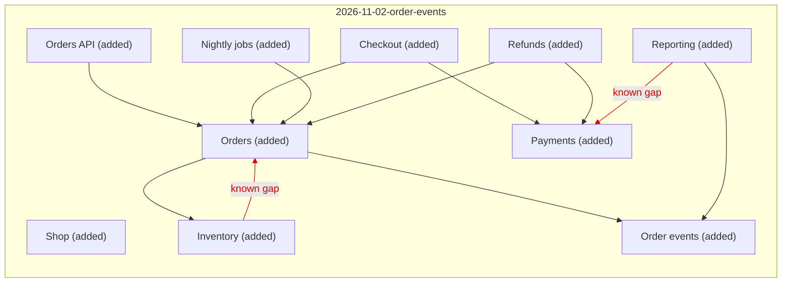

<!-- Generated by architecture-docs from the architecture model. Do not edit. -->

# 2026\-11\-02\-order\-events

- Summary: Order events: the shop system around the eight components; order events \(not yet built\) with orders \-&gt; events and reporting \-&gt; events; reporting \-&gt; payments removed and gapped \(BR\-3\); rules BR\-1 to BR\-5 assigned; the order\-event format decided once for checkout, refunds and reporting\.
- Asked by: specifying\-epics \(docs/epics/order\-events\.md\)
- Run: epic
- Date: 2026\-11\-02
- Approval: Approved by owner on 2026\-11\-02

## Diagram



## What changed

### Elements added

| Element | Title | Description | Code | Rules | Tags |
| --- | --- | --- | --- | --- | --- |
| [shop](../areas/shop.md) | Shop |  |  |  |  |
| [shop\.api](../areas/shop.md) | Orders API |  | shop\.api |  |  |
| [shop\.checkout](../areas/shop.md) | Checkout |  | shop\.checkout | BR\-1 |  |
| [shop\.events](../areas/shop.md) | Order events |  |  | BR\-5 |  |
| [shop\.inventory](../areas/shop.md) | Inventory |  | shop\.inventory |  |  |
| [shop\.jobs](../areas/shop.md) | Nightly jobs |  | shop\.jobs |  |  |
| [shop\.orders](../areas/shop.md) | Orders |  | shop\.orders | BR\-4 |  |
| [shop\.payments](../areas/shop.md) | Payments |  | shop\.payments |  | \#protected |
| [shop\.refunds](../areas/shop.md) | Refunds |  | shop\.refunds | BR\-2 |  |
| [shop\.reporting](../areas/shop.md) | Reporting |  | shop\.reporting | BR\-3 |  |

### Elements removed

- api
- checkout
- inventory
- jobs
- orders
- payments
- refunds
- reporting

### Decisions added

#### order\-event\-format

Checkout, refunds and reporting share one order\-event format, defined by the order events component\.

- Reason: All three capabilities produce or consume the same events about an order \(the epic's shared need, BR\-4 and BR\-5\)\.
- Rejected: Each capability defines its own event shape\.
- Obligations: Every change to an order emits one order event \(BR\-4\)\.; Every order event carries the order id and a sequence number, and a consumer ignores an event it has already seen \(BR\-5\)\.
- Owner: [shop\.events](../areas/shop.md) \(Order events\)
- Compatibility: Changes are additive only\. Removing or renaming anything is a new format version that every bound element adopts together\.
- Status: planned
- Evidence: spec
- Sources: docs/epics/order\-events\.md
- Binds: [shop\.checkout](../areas/shop.md) \(Checkout\), [shop\.orders](../areas/shop.md) \(Orders\), [shop\.refunds](../areas/shop.md) \(Refunds\), [shop\.reporting](../areas/shop.md) \(Reporting\)
- Areas: [shop](../areas/shop.md) \(Shop\)

## Choices not taken

- Each capability defines its own event shape\.
- [order\-event\-format](../areas/shop.md): Each capability defines its own event shape\.

## Known gap

- Added: [shop\.inventory](../areas/shop.md) \(Inventory\) \-&gt; [shop\.orders](../areas/shop.md) \(Orders\)
- Added: [shop\.reporting](../areas/shop.md) \(Reporting\) \-&gt; [shop\.payments](../areas/shop.md) \(Payments\)
- Removed: inventory \(not in the current model\) \-&gt; orders \(not in the current model\)

## Check

- Exit: 0
- Summary: 0 new, 0 stale, 2 known \(likec4 1\.60\.0 from plugin\)

```
Known breaches
  shop.inventory -> shop.orders (1 edges)
  shop.reporting -> shop.payments (1 edges)

0 new, 0 stale, 2 known (likec4 1.60.0 from plugin)
```
